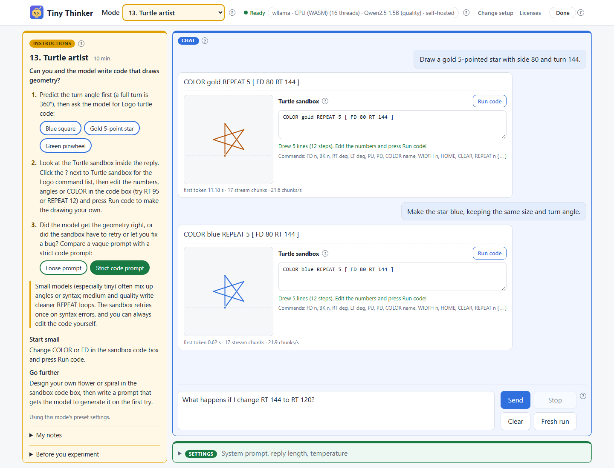

<p align="center"></p>

# Tiny Thinker: Classroom LLM Playground

> [!TIP]
> **Try it live:** [Open Tiny Thinker](https://www.ferzkopp.net/tiny-thinker/) in your browser. No installation or account required.

Learn AI by playing with it. Small, open models run right in the browser, with no accounts or inference server. Questions and replies are processed on-device.

Created by Andreas Schiffler. Source: https://github.com/ferzkopp/tiny-thinker (MIT License).

 

A static HTML/JavaScript playground with no build step or application backend. A static web server is still required. Engine libraries and model assets are downloaded over the network; this is not a fully offline distribution.

## In action



**13. Turtle artist:** ask for a drawing, refine it in conversation, then experiment with the code yourself. This real interaction uses Qwen2.5 1.5B running in the browser through the CPU engine.

## After cloning

Requirements: Python 3.8+ for the helper scripts, a modern browser with WebAssembly SIMD, internet access for downloads, and about 5.5 GB of free disk space for the classroom model set. No Python packages are needed. WebGPU is optional; the CPU engine is the fallback.

From the cloned repository folder:

```powershell
python download_models.py --profile classroom
python download_models.py --profile classroom --check
python serve.py --isolate
```

Open http://localhost:8000. Opening HTML directly with `file://` does not work. Use `--port 8001` if the default port is busy.

The classroom profile prepares all twelve builds: SmolLM2 135M and 360M (English) and Qwen2.5 0.5B and 1.5B (multilingual), each with a CPU GGUF build and f16/f32 WebGPU builds. The download totals about **5.3 GB** (SmolLM2 about 1.36 GB, Qwen2.5 about 3.97 GB). Each student's browser downloads only the model it uses, not the entire set.

To prepare without downloading every model, you can also serve a fresh clone immediately. Missing model builds load from Hugging Face when selected.

## Classroom experiments

The chat includes thirteen original, short activities, numbered in the Mode menu so a teacher can say "start mode 4":

1. **Shakespeare remix:** compare answers in different voices.
2. **Break the silly rule:** test a rule with harmless word games.
3. **Creativity dial:** explore randomness by changing temperature.
4. **Prompt makeover:** improve a vague request with specific details.
5. **Story co-author:** turn AI suggestions into your own story.
6. **Design for good:** brainstorm and improve a useful design.
7. **Fact detective:** check facts and spot invented claims.
8. **Who gets to be the expert?:** explore stereotypes in fictional leader descriptions.
9. **Language explorer:** compare English and Spanish across models.
10. **Bug hunter:** check logic puzzles for step-by-step mistakes.
11. **Socratic coach:** ask for hints and test the feedback.
12. **Make it your own:** give a generic AI draft your personal touch.
13. **Turtle artist:** generate, draw and edit Logo shapes.

See [CLASSROOM.md](CLASSROOM.md) for a sample lesson, mixed-age adaptations, safeguards and research references.

## Using the playground

### Choose an activity

The page opens in **Free chat**, with no activity instructions. Pick a **Mode** in the header to start an experiment with its own instructions and preset settings. Changing modes starts a new conversation but keeps the selected model.

Share an activity using a link such as [Shakespeare remix](https://www.ferzkopp.net/tiny-thinker/index.html?experiment=shakespeare) or [Turtle artist](https://www.ferzkopp.net/tiny-thinker/index.html?experiment=turtle). The device check carries the activity through to chat; links contain no conversation text.

### Find your way around

- **Instructions (amber, left):** follow the steps. Blue-outlined buttons fill in a question; press **Send** when ready. Green-outlined buttons change a setting and start a fresh run; the active choice is filled.
- **Chat (blue):** send questions and compare replies. The header shows when the model is **Ready**. If loading fails, use **Try again** or the CPU fallback offered for GPU failures.
- **Settings (green, bottom):** adjust the system prompt, reply length and temperature. **Restore preset** returns to the activity's settings.
- **Help (?):** open an explanation beside a control. Help works with the keyboard; press Escape to close it.

### Compare runs and save notes

Change one variable at a time when comparing answers.

| Control | What it does |
|---|---|
| **Fresh run** | Clears model context and refills your draft or previous question. Keeps settings, reflection notes and earlier runs for export. |
| **Clear** | Discards the conversation and its export records, but keeps reflection notes. |
| **Mode / Done** | Clears the conversation and reflection notes, with confirmation when there is work to lose. Done returns to Free chat with default settings. |
| **My notes / Download notes** | Records your predictions and observations, then downloads them with conversation records for comparison. |

Conversations and notes live only in the current tab: download them before navigating away or reloading. Model selection and free-chat settings are remembered locally; activity presets do not overwrite saved free-chat settings. There are no student accounts or teacher dashboard.

### Draw with Turtle artist

In **13. Turtle artist**, replies include a drawing and editable Logo code. Change the code and press **Run code** to explore the result. The **?** beside **Turtle sandbox** explains the supported commands and syntax.

Small models can produce incorrect shapes or angles even when the code runs. Check the drawing yourself and use the editor to improve it.

## Device and model selection

- `index.html` checks what the device supports (WebGPU, WASM SIMD, threads, memory, storage). It recommends an engine and model, then redirects to the chat after 5 seconds. Click **Change** to choose a different setup.
- `chat.html` loads the chosen engine and streams replies.

| Tier | Model (Apache 2.0) | WebLLM 0.2.87 (WebGPU) | wllama 3.8.1 (CPU / WASM) |
|---|---|---|---|
| tiny | SmolLM2 135M | q0f16 / q0f32 | GGUF Q4_K_M |
| small | SmolLM2 360M | q4f16_1 / q4f32_1 | GGUF Q4_K_M |
| medium | Qwen2.5 0.5B | q4f16_1 / q4f32_1 | GGUF Q4_K_M |
| quality | Qwen2.5 1.5B | q4f16_1 / q4f32_1 | GGUF Q4_K_M |

WebLLM uses the f16 build when the GPU supports `shader-f16`, otherwise the f32 build. The model list lives in `catalog.json`. JavaScript libraries load from jsDelivr. Models are served from `models/` when self-hosted, otherwise from Hugging Face. Browsers can cache downloads but can also evict them.

All four tiers are part of the classroom profile, so whichever tier the hardware recommender picks is served from your site. On weaker devices, choose tiny or small via Change setup for faster replies; the quality tier needs about 1.6-1.9 GB of GPU memory or a 1.1 GB CPU download per student. A direct CPU starting link is `chat.html?engine=wllama&tier=tiny&experiment=shakespeare`.

## Languages

Language support depends on the model, not the app:

| Tier | Model | Languages |
|---|---|---|
| tiny, small | SmolLM2 135M / 360M | Mainly English. Spanish replies are often broken or switch back to English ([model card](https://huggingface.co/HuggingFaceTB/SmolLM2-360M-Instruct), Limitations). |
| medium, quality | Qwen2.5 0.5B / 1.5B | 29+ languages, including Spanish, French, German, Portuguese, Arabic, Chinese and Japanese ([model card](https://huggingface.co/Qwen/Qwen2.5-0.5B-Instruct)). Quality improves with size. |

For a Spanish-speaking class:

- Choose **medium** (or **quality** on strong devices) via Change setup, or link directly: `chat.html?engine=wllama&tier=medium`.
- Both Qwen2.5 tiers are included in the classroom profile, so they are served from your site.
- The mode instructions, system prompts and starter questions are in English. An English system prompt pulls replies toward English, so add a line such as *"Responde siempre en español."* to the system prompt.
- Medium needs about 1 GB of GPU memory, or about 3 GB of RAM on the CPU engine.

The **Language explorer** mode turns this limitation into an experiment: compare English and Spanish answers, tell the model which language to use, then repeat with a larger model.

## Self-hosting the models

```powershell
python download_models.py --profile classroom                 # all twelve builds, pinned model revisions (~5.3 GB)
python download_models.py --profile classroom --check         # offline readiness check, no changes
python download_models.py                                     # all builds, latest upstream revisions
python download_models.py --tiers tiny small --variants f16   # a subset
python download_models.py --manifest-only                     # rebuild manifest after copying/deleting folders
```

Do not combine `--profile` with explicit tier/engine/variant filters. Without `--profile`, the downloader uses the latest upstream revisions instead of the pinned ones.

`model-downloads.json` records the classroom model revisions (SmolLM2 from the original attribution records, Qwen2.5 pinned on 2026-10-30), GGUF sizes and SHA-256 fingerprints of the compiled libraries. Model URLs use pinned revisions. Library downloads still use the catalog URL, but reject content that does not match the recorded fingerprint, rather than silently accepting an upstream change. Legal notices are retrieved from upstream and are not byte-for-byte locked.

Completed files are reused when their recorded revision and expected size agree. Interrupted builds can reuse files completed by this downloader; an interrupted individual file restarts rather than resuming byte ranges. `.part`, `.revision`, `.inventory.json` and `.complete` are local preparation metadata. Missing files, shard-size mismatches or library hash mismatches fail the check. It is a deployment readiness check, not a cryptographic audit of every model weight.

This creates the following layout:

```
models/
  manifest.json                         # read by the app: which builds are self-hosted
  webllm/<model-id>/resolve/main/...    # MLC weights (WebLLM needs the resolve/main/ segment)
  webllm/<model-id>/LICENSE, ATTRIBUTION.txt
  webllm/libs/*.wasm, ATTRIBUTION.txt   # compiled WebGPU model libraries
  gguf/<name>/<name>.gguf, LICENSE, ATTRIBUTION.txt
```

- Each model folder carries its own license copy, either the upstream `LICENSE` or the Apache 2.0 text. `ATTRIBUTION.txt` records the original model, the copyright holder, the exact source revision and how the files were converted. `licenses.html` lists all of this and links to the local files.
- Builds missing from `manifest.json` fall back to Hugging Face. The badge on the chat page shows which source is used.
- Weights add up to several GB. Git ignores generated model files, while model `LICENSE`, `NOTICE` and `ATTRIBUTION.txt` remain eligible for version control. The generated manifest is intentionally not committed: otherwise a fresh clone would advertise files it does not contain.
- **Git ignore rules do not stop OneDrive sync.** To prepare outside a synced workspace, use `python download_models.py --profile classroom --dest D:\tiny-thinker-models`, then check with the same `--dest` and `--check`. Copy that complete folder to the server as `models/`, next to `index.html`. Local preview looks for `./models`; `--dest` does not change the app's model URL.
- On the server, serve `.gguf`, `.bin` and `.wasm` with long cache lifetimes. Compression only helps for `.json`.

## Run locally

```powershell
python serve.py             # http://localhost:8000
python serve.py --isolate   # adds COOP/COEP -> multithreaded wllama
```

Opening the files directly (`file://`) does not work.

## Host on your web server

After preparing and checking the models, upload these paths together, preserving their relative layout:

- The root HTML, JavaScript and CSS files, `icon.svg`, `catalog.json`, `LICENSE` and `robots.txt`.
- The server config for your host: `web.config` (IIS) or `.htaccess` (Apache). Uploading both is harmless; each server ignores the other's file.
- The `engines/` directory.
- The complete generated `models/` directory, including `manifest.json`, model assets, licenses and attribution. Exclude unfinished `.part` files. The hidden preparation metadata can be kept for later validation; it is not used by browser inference.

Do not upload `.git/`, local environments, `node_modules/`, tests or test screenshots. A Git checkout or `git archive` alone does **not** contain the ignored model payloads: run the downloader before deployment or upload the prepared model folder separately. No server-side Python is required for the deployed site. The same layout works in a subdirectory, such as `/playground/`.

### Clean up before uploading

Running the downloader or the [tests](#development-checks) creates local folders that do not belong on the server: `__pycache__/` (in the root and in `tests/`), `test-results/` (browser test screenshots and notes) and, if you installed Playwright, `node_modules/`. An interrupted download can also leave `*.part` files in `models/`. All of these are git-ignored, but upload tools copy them anyway. Remove them first:

```powershell
# Windows PowerShell, from the repository folder
Remove-Item -Recurse -Force __pycache__, tests\__pycache__, test-results, node_modules -ErrorAction SilentlyContinue
Get-ChildItem models -Recurse -Filter *.part | Remove-Item
python download_models.py --profile classroom --check
```

```bash
# macOS / Linux
rm -rf __pycache__ tests/__pycache__ test-results node_modules
find models -name '*.part' -delete
python3 download_models.py --profile classroom --check
```

The final check confirms the models are still complete. Then upload only the paths listed above; the `tests/` folder itself stays local.

Requirements:

1. **HTTPS.** WebGPU and the storage APIs only work in a secure context. `localhost` also counts as secure.
2. **Correct MIME types:** `.js`/`.mjs` -> `text/javascript`, `.wasm` -> `application/wasm`, `.json` -> `application/json`. Ensure the host permits large `.gguf` and `.bin` downloads.
3. **Optional:** cross-origin isolation, for faster CPU inference. Add these two headers:

   ```
   Cross-Origin-Opener-Policy: same-origin
   Cross-Origin-Embedder-Policy: require-corp
   ```

   Without them everything still works, but wllama runs single-threaded. jsDelivr, Hugging Face and raw.githubusercontent.com all send CORS headers, so they load fine under `require-corp`. After you enable the headers, open the check page and make sure "Multithreaded WebAssembly" shows ✓.

The repository includes ready-made config files for IIS and Apache that set all of the above: isolation headers, MIME types (including `.wasm` and `.gguf`) and a 30-day browser cache for model files. They apply to the folder they are in, so the site also works in a subdirectory.

### IIS: [web.config](web.config)

Upload it with the site; no changes needed. It removes and re-adds each MIME type, so it does not clash with types IIS already defines. If the site lives in a subfolder of an existing IIS application, it is merged with the parent configuration.

### Apache: [.htaccess](.htaccess)

Upload it with the site. It needs `mod_headers` and `mod_mime` (both standard) and `AllowOverride FileInfo` or `All` for the folder; otherwise Apache ignores the file. Some upload tools hide dotfiles, so check it arrived.

### nginx

nginx does not read config from the site folder. Add this to the server configuration, adjusting the path:

```nginx
location /tiny-thinker/ {
    add_header Cross-Origin-Opener-Policy "same-origin" always;
    add_header Cross-Origin-Embedder-Policy "require-corp" always;
    # A types block replaces nginx's default list here, so it must name every file type the site uses.
    types { text/html html; text/css css; text/javascript js mjs; application/json json; application/wasm wasm; application/octet-stream gguf bin; image/svg+xml svg; text/plain txt; text/markdown md; }
}
location ~* ^/tiny-thinker/models/.*\.(gguf|bin|wasm)$ {
    add_header Cross-Origin-Opener-Policy "same-origin" always;
    add_header Cross-Origin-Embedder-Policy "require-corp" always;
    add_header Cache-Control "public, max-age=2592000";
}
```

## Notes

- Change setup: `index.html?manual=1`. Setting the chat URL directly also works, e.g. `chat.html?engine=wllama&tier=tiny`.
- If WebLLM fails to load or loses the GPU, the chat offers a one-click switch to the CPU engine.
- To free browser storage, use the browser's own site settings (clear site data for this site). Models are downloaded again on the next visit.
- To upgrade a library, change the versions in `catalog.json` and in `engines/webllm-worker.js`. Then check that the model IDs and `libBase` still match WebLLM's `prebuiltAppConfig`, and rerun `download_models.py`.

## Search engines

The pages carry a description, author, license and Open Graph tags for link previews; `index.html` also has schema.org `WebApplication` data. The chat page is marked `noindex` because without a saved setup it only redirects to the device check. [robots.txt](robots.txt) keeps crawlers out of `models/` (gigabytes of weights) and `tests/`. Crawlers only read it at the site root, so if the site lives in a subfolder, copy its rules into the root `robots.txt` with the folder prefix.

## Acknowledgements

This project was developed with AI assistance: OpenAI GPT 6.1 Sol, Anthropic Claude 5.5 and Google Gemini 4 Argon were used for research, design, code, tests and documentation, reviewed and directed by the author. The models running in the app (SmolLM2, Qwen2.5) and the engines (WebLLM, wllama) are separate open-source projects; see [licenses.html](licenses.html).

## Privacy and classroom limits

The app does not intentionally send prompts or replies to an inference service. Conversations and reflection notes are not saved to localStorage; settings and device/model choices are. Static hosts and third-party asset hosts can see normal requests, including IP addresses. Dependencies downloaded from CDNs execute in the browser, so choose and review those dependencies accordingly.

Self-hosting the weights does not self-host the engine libraries, remove all external requests, or guarantee an offline reload. No service worker is included. Small open models can invent facts, ignore instructions, repeat stereotypes or produce inappropriate text. Prompts are not safety filters. Use teacher supervision and your school's policies, particularly for younger students, and keep personal information out of prompts and notes.

## Development checks

### Implementation notes

- **Activity catalog:** [experiments.js](experiments.js) defines the modes. Their menu numbers follow catalog order, so adding or reordering activities renumbers them. Unknown activity IDs in links fall back to Free chat.
- **Small-model instructions:** tiny and small (SmolLM2) often ignore system prompts. With `weakSystemPrompt` enabled in [catalog.json](catalog.json), the app also repeats those instructions before the newest question; the displayed question is unchanged. In a limited Shakespeare comparison, in-style replies rose from 0/6 to 4/6 on tiny and from 2/6 to 6/6 on small.
- **Turtle sandbox:** replies render as inline SVG using a restricted Logo interpreter, not arbitrary JavaScript. Supported commands are `FD`, `BK`, `RT`, `LT`, `PU`, `PD`, `COLOR`, `WIDTH`, `HOME`, `CLEAR` and `REPEAT n [ ... ]`. Syntax errors or empty drawings trigger one automatic repair attempt with parser feedback.
- **Turtle evaluation:** across four drawing tasks (square, triangle, star and pinwheel), tiny produced drawable code on 3/4 first attempts and 4/4 after repair; small, medium and quality produced drawable code on 4/4 first attempts. These limited checks do not establish shape correctness; angles can still need editing.

### Run the checks

No Node packages are required to run the app. For the standard-library tests, use Python 3.8+ and a recent Node.js with built-in ES-module detection (Node 22.7+):

```powershell
python -m unittest discover -s tests -p test_download_models.py
node --test tests/experiments.test.js
python download_models.py --profile classroom --check
```

Optional UI checks use Playwright and a Chromium install. If you do not already have Playwright, install it locally for testing only:

```powershell
npm install --no-save --package-lock=false playwright
npx playwright install chromium
python serve.py --isolate --port 8765
```

In a second terminal:

```powershell
node tests/browser-smoke.mjs
node tests/browser-smoke.mjs --real-cpu
node tests/browser-smoke.mjs --real-gpu
```

The smoke test normally substitutes a delayed fake engine to test presets, popups, late replies after reset, exports, routing and mobile layout without model downloads. `--real-cpu` additionally loads the local tiny CPU model and generates a short reply, requiring CDN access. `--real-gpu` tries the GPU build and reports a skip if no adapter is available. Screenshots go to ignored `test-results/`. Set `PREVIEW_URL` for another preview address, or `PLAYWRIGHT_MODULE` to the absolute entry-module path of an existing Playwright installation.

The tests leave `__pycache__/` and `test-results/` folders behind; see [Clean up before uploading](#clean-up-before-uploading).
